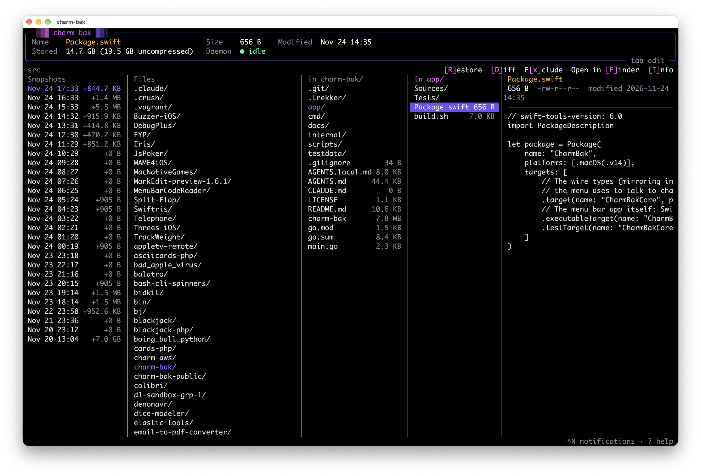

# charm-bak

Backups for a Mac and the Linux, Mac and Windows machines around it, to storage you own, with a terminal UI you'd actually want to open.

charm-bak is a menu bar app, a background daemon and a [Charm](https://charm.sh)-style TUI wrapped around [restic](https://restic.net). restic does the hard part: encrypted, deduplicated, compressed snapshots in S3, Backblaze B2, a drive, or anything else it supports. charm-bak does everything around it: scheduling, retention, credentials, a browser for your history, restore, diff, and running the same thing on other machines without SSH.

> Status: 0.6.0. It backs up the author's Mac and home server every hour, and has been paired with a second Mac and a Windows 11 machine as remotes. What's still missing is listed under [Not there yet](#not-there-yet).



## Why

restic is an excellent engine and deliberately nothing more. It has no scheduler, no config file, no place to keep credentials, and no interface beyond its commands. Using it day to day means writing launchd jobs and wrapper scripts, deciding where the repository password lives, remembering the `forget` flags, and reading JSON to find the file you deleted last Tuesday.

The tools that do have an interface each gave up something I wanted:

- **Time Machine** needs a local or network disk. It has no cloud destination.
- **Hosted backup services** are simple, but the data sits in their format on their storage, and the retention choices are theirs.
- **Arq** backs up to your own storage and is good. It is paid, closed source, and stores data in its own format.
- **Kopia** is a capable engine with its own scheduler and desktop app. charm-bak builds on restic instead: see [Why restic](#why-restic).
- **Backrest** is a web UI and scheduler for restic. It suits a server you reach through a browser. I wanted something native to the Mac and to the terminal.

What sets charm-bak apart is that it looks after every machine you have from one place. Your Mac is the control centre for any number of remotes: a Linux server, another Mac, a Windows PC. Each backs up on its own schedule with its own credentials, whether the Mac is on or not, and you add, configure, watch, browse and restore all of them from the one TUI, with no SSH and nothing to sign in to on each. A failure anywhere arrives as a notification on the Mac, and a machine that has died can still be browsed and restored from, because the Mac reads its backups directly.

charm-bak is the missing layer for someone who wants restic's engine, their own bucket, every machine in one place, and no homework.

## What it does

**Backs up on its own.** Each machine's daemon checks every minute for what's due, so runs missed while a laptop slept catch up on wake. Backups, cleanup and integrity checks are all scheduled for you. A failed run posts a macOS notification, and so does a backup that had to skip files it couldn't read (a warning: the snapshot is there, without them); successes stay quiet. `^N` lists past notifications, and Enter on one shows the whole story: when, how long, and the full reason, or every skipped file and why. Clicking a notification opens those details in the TUI you have running and brings its window forward, down to the tab in Terminal, iTerm2 and kitty, and the window inside tmux or screen. kitty needs its remote control on for that; the TUI offers the two lines for `kitty.conf` the first time.

**Sets itself up.** First launch walks through one decision per screen: where the backups go, the details, a check that it works, and the recovery key. For S3 it can sign in to AWS in the browser and make the bucket and a key limited to that machine's own folder. The repository password is generated for you, stored in the Keychain, and shown once to write down.

**Lets you browse history like a file manager.** Sources, snapshots and files sit in columns, with a preview on the right. Press space for a Quick Look-style info panel that follows the cursor as you move.

**Is fast to browse.** Every restic call pays a second or so of startup, so charm-bak lists each snapshot's whole tree once, in the background, and keeps it in a local SQLite cache. Opening a snapshot you've looked at before is instant, even after a restart, and the newest one is warmed as soon as you select its source.

**Shows what each backup actually did.** Every snapshot shows how much new data it stored, and `c` lists exactly what it added, removed and changed since the one before, through the whole tree. Files whose contents are the same but whose details changed (a timestamp, permissions) are listed too, muted, which explains a backup that stored new data without any file's contents changing.

**Restores and compares.** Restore one file or a whole tree, as a copy or in place, onto the machine it came from or onto this Mac. Diff any file or folder in a snapshot against what's on disk now.

**Picks what to back up by ticking boxes.** The folder picker is a tree over the live disk: tick what's in, untick what's out. Patterns such as `node_modules` or `*.tmp` go in a list that explains what each one matches.

**Keeps what you'd expect.** Retention is one choice: 1 month, 1 year, 3 years, or forever. Each thins out the way Time Machine does: every backup for a day, then dailies, weeklies and monthlies. Custom counts are there if you want them. Pin a snapshot and it's never removed.

**Takes things back out.** Backed up something you shouldn't have? Exclude it from future runs, or remove it from past snapshots too.

**Runs on your other machines without SSH.** Add Remote shows one command to paste on a Linux box or another Mac, or into an administrator PowerShell on Windows (Tab switches between them). It installs the same daemon there as a service (on Windows with restic from winget, Volume Shadow Copy for open files, and a firewall rule), pairs it with this Mac over mutually authenticated TLS, and from then on that machine backs up on its own schedule with its own credentials, whether the Mac is awake or not. Removing one uninstalls everything the command installed there; if you also delete its backups, the AWS user charm-bak made for it goes too. You configure, browse and restore all of them from the one TUI, and their failures arrive as notifications on the Mac.

**Keeps working when a machine is down.** The Mac reads each remote's repository itself rather than asking the remote, so a server that's crashed or a laptop that's asleep can still be browsed, compared and restored from, which is exactly when you need it. Actions that need the machine itself (editing its sources, backing it up now) are dimmed until it's back, and it's picked up within seconds when it returns.

**Updates its remotes itself.** The app carries the daemon built for Linux and Windows (amd64 and arm64) and for Mac remotes, and whenever the Mac connects to a remote running a different build, it sends the new one over the paired connection; the remote checks it, swaps itself and restarts in place. There's nothing to install or update by hand on a remote after the first command.

**Stays out of the way of restic.** The repository is a plain restic repository. `eval "$(charm-bak -env)"` sets up a shell so any `restic` command works against it, and if charm-bak disappeared tomorrow, restic alone could restore everything.

## How it compares

| | charm-bak | restic alone | Backrest | Kopia + KopiaUI | Time Machine | Arq |
|---|---|---|---|---|---|---|
| Storage you own (S3, B2, …) | yes | yes | yes | yes | local or network disk only | yes |
| Open repository format | restic's, with a published spec | same | same | Kopia's own | Apple's | Arq's own |
| Scheduling built in | yes, catches up after sleep | no | yes | yes | yes | yes |
| Interface | TUI and menu bar | command line | web | desktop app | system UI | desktop app |
| Credentials handled | Keychain, per-machine keys made for you | you decide | in its config | in its config | n/a | in the app |
| Several machines from one place | yes, paired daemons | by hand | not checked | per machine | no | per machine |
| Diff a backed-up file or folder against the live disk | yes | between snapshots only | not that I know of | not that I know of | no | not that I know of |
| Open source | yes | yes | yes | yes | no | no |

The other tools' columns are my understanding as of November 2026, not a tested review; check their documentation before relying on a cell. Sources: [Backrest](https://garethgeorge.github.io/backrest), [Arq pricing](https://arqbackup.com/pricing/), [Time Machine](https://support.apple.com/en-us/104984), [Kopia](https://kopia.io/docs/), [restic](https://restic.readthedocs.io).

What charm-bak deliberately doesn't do: it isn't an engine (restic is), it doesn't manage buckets beyond creating one, it doesn't mount snapshots as a drive yet, and its TUI and menu bar app are macOS only. Linux and Windows machines can be backed up as remotes; a desktop UI for them is far down the list.

## Why restic

A backup engine is the hard part, and restic has already done it well, in the open, under the BSD-2 licence. A new backup tool has no business reinventing that. charm-bak doesn't: everything below is restic's, and charm-bak is the layer around it.

What restic does:

- **Maps a filesystem onto cheap object storage.** It splits files into content-defined chunks, stores each chunk once and bundles them into larger files, so a backup uploads only what changed, a moved or renamed file costs nothing, and a year of hourly snapshots takes little more than one.
- **Encrypts everything on your machine** before it leaves, so the storage provider only ever holds ciphertext.
- **Compresses** what it stores.
- **Talks to almost any storage:** a local disk, SFTP, its own REST server, Amazon S3 and S3-compatible services, Backblaze B2, Azure, Google Cloud Storage, and anything [rclone](https://rclone.org) reaches.
- **Keeps every snapshot whole and browsable:** list, search, read a single file, compare two snapshots, restore all or part of one, or mount the repository as a folder.
- **Ages out old snapshots** by hourly, daily, weekly, monthly and yearly rules, and reclaims the space.
- **Checks itself:** verifies the repository's structure and reads back stored data, and has commands to repair it.
- **Edits history when you need it to:** rewrite snapshots to drop something that shouldn't have been backed up, or copy snapshots to another repository.
- **Lets several machines share one repository,** with locking so they don't trip over each other.

And why it's the engine to trust with years of history:

- **A documented format.** restic publishes a byte-level specification of its repository, detailed enough that an independent implementation exists. Your backups don't depend on any one program being around to read them.
- **Careful releases.** When a bug can put data at risk, restic's changelog says who's affected, how to check and how to repair. Since 0.16.4 it verifies each file's data before uploading it.
- **A long record.** It has been developed in the open since 2014, by a small team and a large community.
- **Built to be driven.** A plain command line with JSON output, so charm-bak runs it without reaching into its internals, and you can always run it yourself.

charm-bak uses most of this today. Mounting isn't wired up yet; until it is, `restic mount` works on any charm-bak repository by hand. Details of every feature are in [restic's documentation](https://restic.readthedocs.io).

## How it's built

Three parts, deliberately separate:

- **`charm-bak-daemon`** (Go) owns everything on its machine: sources, schedule, retention, history, the repository and its credentials, and every restic call. The same code runs on the Mac and on remotes.
- **`charm-bak.app`** (Swift, thin) is the menu bar icon, notifications and login item. It carries the daemon inside its bundle and starts it as a child, so the daemon inherits the app's Full Disk Access.
- **The TUI** (Go, [Bubble Tea](https://github.com/charmbracelet/bubbletea)) is a pure client. It holds no credentials and never touches the repository; it talks to the daemon over a Unix socket.

Secrets stay on the machine that uses them: in the Keychain on a Mac, in files only root (Linux) or SYSTEM and Administrators (Windows) can read on a remote. They are handed to restic through its environment for that one process and never appear on a command line or in a log.

`docs/design.md` covers the design, `docs/protocol.md` the socket protocol, and `AGENTS.md` the running record of decisions.

## Install

Download the latest `charm-bak-<version>.zip` from [Releases](https://github.com/alokdhir/charm-bak/releases), unzip it, move `charm-bak.app` to Applications and open it. It's signed with a Developer ID and notarized by Apple, and runs on Apple silicon and Intel Macs with macOS 14 or later.

restic: if you have restic 0.18 or later installed (`brew install restic`), charm-bak uses it, and you keep updating it as usual. If not, charm-bak downloads restic's own release for itself, checked against the checksums restic signs, and keeps that copy up to date.

Then:

1. Grant **Full Disk Access** to charm-bak in System Settings › Privacy & Security, so it can read Documents, Mail and the like. The menu warns while it's missing.
2. Choose **Open TUI** from the menu bar icon. Setup opens by itself.
3. Tick the folders to back up.

To run the TUI as `charm-bak` from any terminal, link it onto your PATH:

```sh
ln -s /Applications/charm-bak.app/Contents/MacOS/charm-bak-tui /usr/local/bin/charm-bak
```

### Already using restic?

Point setup at your existing repository: it finds the repository there and asks for its password instead of making a new one. Every snapshot in it shows up, under "untagged" for the ones charm-bak didn't make, ready to browse, compare and restore. Add sources with the picker and charm-bak takes over from there.

One thing to settle: if your own scripts keep running `restic forget`, their rules apply to charm-bak's snapshots too, since a plain `forget` covers the whole repository. charm-bak's own `forget` only ever touches the snapshots it made. Retire the old jobs once charm-bak runs your backups, so two schedulers aren't pruning one repository.

### Building from source

Requirements: macOS 14 or later, Go 1.26 and Xcode's command line tools, and a code-signing identity (a free Apple Development certificate is enough).

```sh
git clone https://github.com/alokdhir/charm-bak.git
cd charm-bak
app/build.sh
open ~/Applications/charm-bak.app
```

`app/build.sh` builds the app, the daemon and the TUI, signs them, installs `~/Applications/charm-bak.app`, and links `charm-bak` onto your PATH if `/usr/local/bin` is writable. Set `SIGN_ID` to choose the identity. Keep the same identity across builds: macOS ties Full Disk Access to it. `scripts/release.sh` makes a release: universal, signed with a Developer ID, notarized and zipped.

To try the interface without setting anything up, `go run . --fake` runs the TUI on fixture data.

## Storage and keys

Each machine has a repository of its own, in any storage restic supports. For Amazon S3, setup can make the keys for you; for everything else (Backblaze B2, other S3-compatible services, Azure, Google Cloud Storage, SFTP, a REST server, a drive) you make a key in that service's console and paste it in. For B2, an application key limited to the bucket, and to a name prefix per machine, keeps each machine to its own backups.

### AWS keys made for you

Pick S3, then **Sign in to AWS**. charm-bak runs `aws login` in your browser, into a throwaway configuration folder that's deleted afterwards: your own `~/.aws` is never read or changed, and the sign-in isn't kept. With it, charm-bak makes:

- **The bucket**, if it isn't there yet: private, encrypted (SSE-S3), moving to S3 Intelligent-Tiering, with nothing that expires or archives objects (restic manages them). A bucket that exists is used as it is.
- **A limit** (managed policy `charm-bak-boundary-<bucket>`): reading, writing and listing that one bucket is the most any machine's key can ever do.
- **A key manager** (IAM user `charm-bak-manager`), whose key stays in your Mac's Keychain. It can only create, change and delete users under `/charm-bak/`, and only with that limit attached. It has no access to any bucket.
- **The machine's own user** (`charm-bak-<machine>` under `/charm-bak/`), with a policy for its own folder in the bucket, `<bucket>/<machine>/`, and nothing else. Its key goes to that machine only, with a copy in your Mac's Keychain so the Mac can read that machine's backups.

The next machine needs no sign-in: **Make <machine> a key** has the key manager make its user. Removing a machine and deleting its backups deletes its user too, if charm-bak made it. **I have a key** takes one you made yourself instead, and charm-bak then leaves your IAM users alone.

**Keys it made, it rotates.** Every 90 days (the age AWS's own checks flag), charm-bak follows AWS's procedure for each machine: the key manager makes a second key, the machine is moved onto it and checked (its repository must open with it), and the old key is deleted. If any step fails, the machine keeps its current key and the failure is a notification like any other. A machine that's off or busy is tried again within the hour. `n` on a machine's header does it now, if you think a key has leaked; its info shows when the key was made.

**Keys from before can be adopted.** A machine using an AWS key charm-bak didn't make, for a user named `charm-bak-<machine>`, is offered adoption once (and **Adopt key** on its header does it any time). One AWS sign-in covers every machine waiting: each user moves under `/charm-bak/` with the same limits a made user has, and from then on charm-bak rotates its key and removes its user with the machine. The key itself stays the same until the first rotation.

## Remotes and your network

One Mac is in charge. It runs the TUI and the menu bar app, and its daemon configures and follows every remote. Each remote runs the same daemon, backing up to its own repository on its own schedule and with its own credentials. The Mac also reads every remote's repository directly, so a remote that's off or broken can still be browsed and restored from.

```
 your Mac, in charge                                  each remote: Linux, a Mac or Windows
┌─────────────────────────────┐                      ┌─────────────────────────────┐
│ TUI, menu bar               │                      │ charm-bak-daemon            │
│   │ Unix socket             │                      │ its own sources, schedule   │
│   ▼                         │                      │ and credentials; backs up   │
│ charm-bak-daemon            │ ──── TCP 7457 ─────▶ │ on its own, whether the     │
│                             │     mutual TLS:      │ Mac is on or not            │
│                             │     configure it,    │                             │
│                             │     follow its jobs, │                             │
│                             │     send updates     │                             │
└───────┬─────────────┬───────┘                      └──────────────┬──────────────┘
        │ backs up    │ reads, to browse and restore                │ backs up
        ▼             │ (even while the remote is down)             ▼
 ┌─────────────┐      └───────────────────────────────────▶ ┌─────────────────┐
 │ Mac's repo  │                                            │ remote's repo   │
 └─────────────┘            storage you own                 └─────────────────┘
```

Adding a remote needs two connections to get through any firewall between the machines:

| Port | Direction | When | What |
|---|---|---|---|
| TCP **7457** | Mac → remote | always | The Mac's daemon connects to the remote's to configure it, follow its jobs and send updates. The remote listens here; nothing else does. |
| TCP **7458** | remote → Mac | only while Add Remote is open | The remote fetches its installer and daemon from the Mac and pairs. The Mac stops listening when pairing ends. |

Port 7457 is TLS between keys pinned at pairing, so a device that isn't paired gets nothing from it. Port 7458 serves the installer only to whoever has the one-time code in the command you paste. If the remote runs a host firewall (`ufw`, `firewalld`, the macOS firewall), allow inbound TCP 7457 from the Mac; on Windows the installer adds that rule itself. Each machine also needs its own outbound route to the storage it backs up to; backups don't pass through the Mac.

The Mac finds a remote at the address it had when paired. If that changes, `e` on the remote's header has an Address tab. A remote that's off or unreachable is retried every few seconds and picked up when it's back; meanwhile its backups stay browsable and restorable from the Mac.

## Keys

| Key | Does |
|---|---|
| `←` `→` `↑` `↓` | move between and within columns |
| `a` `e` `x` | add, edit, remove (a source, or what's selected) |
| `b` | back up now |
| `r` | restore (Snapshots, Files); add a remote (Sources) |
| `c` | what a snapshot changed since the one before |
| `d` | diff a file or folder against the live disk |
| `p` | pin a snapshot |
| `n` `o` | a new AWS key now, adopt a key charm-bak didn't make (a machine's header) |
| `i` or space | info, Quick Look style |
| `^T` `^N` | running jobs, past notifications |
| `?` | everything else |

## Security

- **Secrets stay where they're used.** Repository passwords and storage keys live in the Mac's Keychain, and on a remote in files only root (Linux, macOS) or SYSTEM and Administrators (Windows) can read. They reach restic through that one process's environment, never a command line or a log. The TUI holds none: it talks to the daemon over a Unix socket only your user can open.
- **Remotes are paired, not trusted by network.** Each daemon makes its own key (ECDSA P-256) the first time it starts; none ship with the app. The command you paste carries a one-time code (80 random bits, ten minutes, one use) and the Mac's key fingerprint, which `curl` checks before running anything. From then on the Mac and each remote talk only TLS 1.3 between keys pinned at pairing: port 7457 gives a device that isn't paired nothing at all.
- **AWS keys charm-bak made are rotated every 90 days**, and on demand. Each is limited to its machine's own folder in the bucket, under a limit no key it makes can exceed.
- **Updates to remotes** travel over that pinned connection and are checked against their hash before a remote swaps them in.
- **restic itself**, when charm-bak fetches it, is checked against the checksums restic signs with its release key.
- **A remote can't reach into the Mac.** The Mac reads each remote's backups itself, at the location it set them up at, and nothing a repository holds (snapshot IDs, paths, names) can turn into an option for restic or an escape sequence in your terminal.
- **The app is signed with a Developer ID and notarized by Apple.**

What it can't protect against: anything running as your user on the Mac can read your Keychain the way charm-bak does, as with any app that keeps keys there, and anyone with root on a machine has that machine's backups. Found a hole? Please report it privately through GitHub's security advisories for this repository rather than in an issue.

## Not there yet

- **Mounting snapshots as a folder isn't in the TUI.** restic can do it, and you can run it by hand against this Mac's repository; see [Mounting by hand](#mounting-by-hand).
- **Linux and Windows desktops** have no UI of their own; they are remotes of a Mac.

## Mounting by hand

restic can mount the whole repository as a read-only folder, with every snapshot inside it as ordinary files: handy for opening old versions in other apps, or comparing folders with your usual diff tool. charm-bak doesn't do this from the TUI yet, but its repository is a plain restic repository, so you can:

1. Install [macFUSE](https://macfuse.github.io) and allow its system extension in System Settings › Privacy & Security. On Apple Silicon that means a restart.
2. In a terminal, give restic the repository and its credentials, mount it, and leave that terminal running:

   ```sh
   eval "$(charm-bak -env)"        # this Mac's repository; the password and key come from the Keychain
   mkdir -p ~/charm-bak-mount
   restic mount ~/charm-bak-mount
   ```

3. Open `~/charm-bak-mount` in Finder. `snapshots/` has one folder per snapshot, by time, holding the full paths that were backed up; `tags/` groups them by source (`src:<id>`, the Tag in a source's info panel). To mount one source only, add `--tag src:<id>` to the `restic mount` line.
4. When you're done, press Ctrl-C in that terminal to unmount. restic holds a lock on the repository while it's mounted, so don't leave it mounted: charm-bak's weekly cleanup can't run until it's gone.

`charm-bak -env` covers this Mac's repository. The same `eval` line works for running any other restic command by hand, too. restic's own guide: [mounting a repository](https://restic.readthedocs.io/en/stable/050_restore.html#restore-using-mount). charm-bak hasn't tested `restic mount` on recent macOS versions.

## Development

```sh
go build ./... && go vet ./... && gofmt -l . && go test ./...
go test -race ./internal/daemon ./internal/client
cd app && swift test
```

The daemon's tests run real restic against temporary folders. Nothing in the test suite touches your repository, Keychain or AWS account.

## Licence

MIT. See `LICENSE`. restic is BSD-2-Clause and is not bundled; charm-bak runs the `restic` you install.
